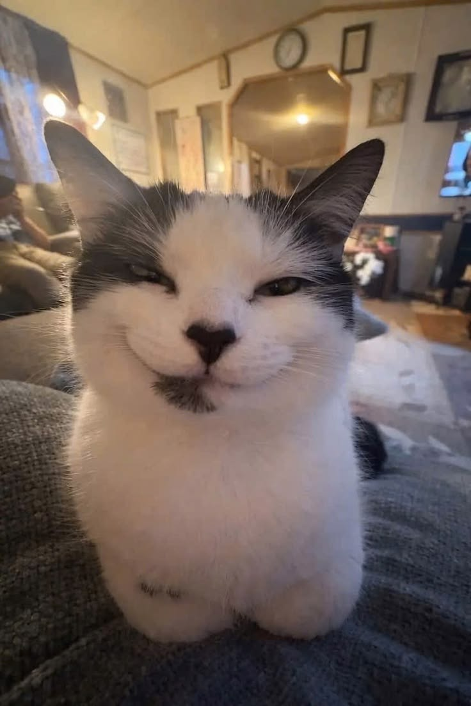
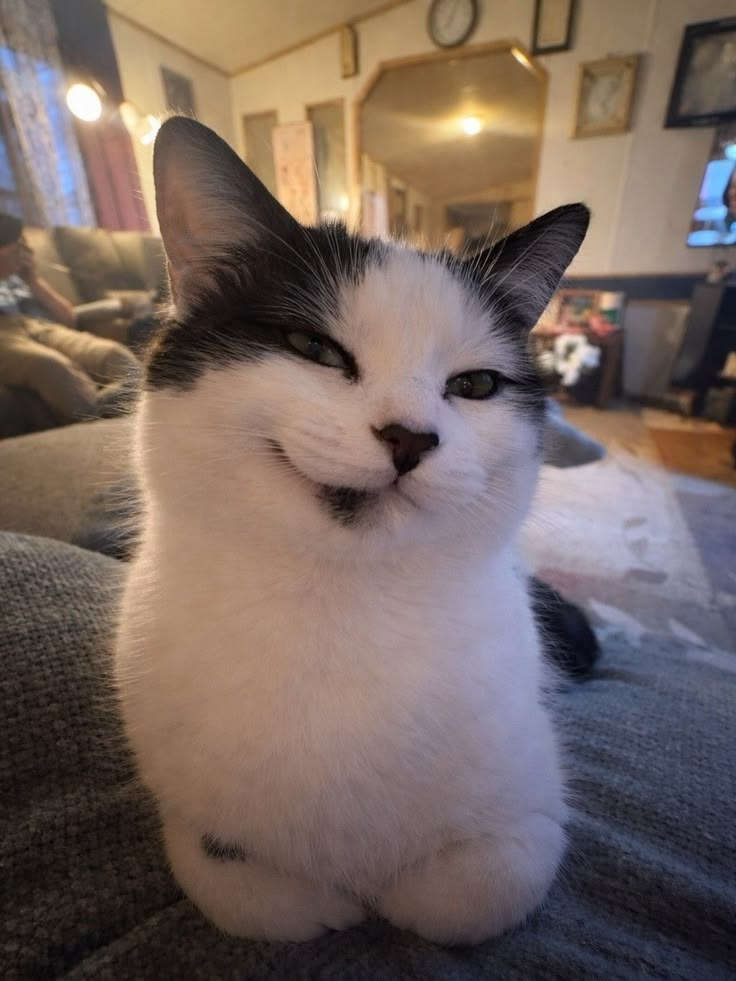
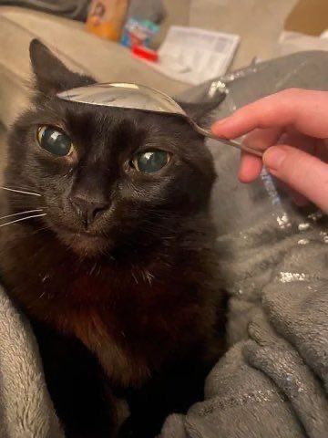

<div align="center">

# hey, i'm aleks


<br>



<sub><i>this cat approves of your visit</i></sub>

<br>

**computer engineering student · software developer · videographer · photographer**

<br>

[](https://github.com/alekslime)
[](https://www.linkedin.com/in/aleks-lime-896673329/)

</div>

---

## a little about me

I'm a Computer Engineering student based in Tirana, Albania.

I enjoy building things, figuring out how they work, and occasionally making my life unnecessarily difficult by deciding to build something from scratch.

Most of my time goes into software development, experimenting with hardware and Linux, or working behind a camera.

- Building **Resonant**, my personal AI learning companion.
- Exploring **Linux, operating systems, computer architecture and low-level programming**.
- Interested in **AI, software engineering, embedded systems and hardware**.
- Working in **videography, photography, video production and post-production**.

I like having both a technical and creative outlet. They're pretty different worlds, but I enjoy both equally.

---

## Resonant

**A personal AI teacher that talks, reads, sees, and remembers.**

<sub>My main project. Something I've been building and refining for years.</sub>

<div align="center">

<br/><sub><i>confidence level: ascended</i></sub>
</div>

<br>

Resonant is an Android learning companion designed with blind and visually impaired students in mind.

The goal is to make educational material accessible through conversation, voice interaction, and an adaptive learning experience rather than relying entirely on visual interfaces.

Some of the things I'm working on:

- Conversational AI tutoring.
- Voice-based interaction and spoken lessons.
- Uploading and understanding educational materials.
- Adaptive learning and progress tracking.
- Accessible Android interface.
- Haptic and gesture-based controls.
- Adjustable text, contrast and accessibility settings.
- Making learning materials easier to navigate, understand and revisit.

**A few milestones:**

- 1st place at **GDG Tirana 2026**.
- Participated in the **Meta Global AI Developer Hackathon 2026**.
- Presented at Future2Tech, including to representatives of the French Embassy.
- Working towards getting the prototype into the hands of actual students.

[](https://github.com/alekslime/Resonant-AI)

---

## other things i've built

### Sentry

A local voice assistant for my PC.

<div align="center">

<br/><sub><i>confidence level: on duty, still under construction</i></sub>
</div>

<br>

The idea is to have a useful desktop companion that runs locally, without depending on cloud AI services, subscriptions or sending personal data to external servers.

Things I've been experimenting with:

- Local language models.
- Voice recognition and speech synthesis.
- Computer vision and OCR.
- Screen understanding.
- Desktop interaction.
- Windows integration.
- Wake-word activation.

Built with privacy and local execution as priorities. Still a work in progress.

---

## things i work with

<div align="center">

### Languages


### Frameworks & Development


### Tools & Technologies


### Creative Software


</div>

---

## behind the camera

Software isn't the only thing I spend my time building.

I also work in videography and photography, covering everything from commercial productions and automotive campaigns to events, weddings and personal photoshoots.

I've worked on video production, filming, photography, video editing and photo editing for:

**Brands & organizations**

- Ford Albania
- Hyundai Albania
- Chery Albania
- MG Albania
- Hospital of the Lady of Good Counsel
- AMG Energy
- Elektrik Taxi
- Typical

**Other productions**

- Corporate and promotional videos.
- Automotive photography and videography.
- Events and concerts.
- Weddings and engagements.
- Birthdays and private celebrations.
- Portrait and personal photoshoots.
- Social media content and short-form video.
- Various other commercial and personal productions.

My work usually involves more than just pressing record. Depending on the project, I handle filming, camera setup, composition, editing, color correction, sound and final delivery.

I enjoy the entire process, from being behind the camera to putting together the final result.

---

## GitHub

<div align="center">


<br>


</div>

---

## when i'm not coding or working

- Video production and photography.
- Games.
- Music.
- Hardware projects.
- Linux customization and ricing.
- Taking things apart to see how they work.

<div align="center">
<table>
  <tr>
    <td align="center"><br/><sub>hello</sub></td>
    <td align="center"><br/><sub>spoon hat</sub></td>
    <td align="center"><br/><sub>4k quality</sub></td>
    <td align="center"><br/><sub>guest appearance</sub></td>
  </tr>
</table>
</div>

---

## right now

```text
building       → Resonant
developing     → Sentry
learning       → Linux / systems / low-level programming
working on     → software + video production
experimenting  → hardware, Android & local AI
```

---

<div align="center">

### thanks for stopping by.

**check out my projects down below**

<sub>there's probably something interesting in there.</sub>

</div>
